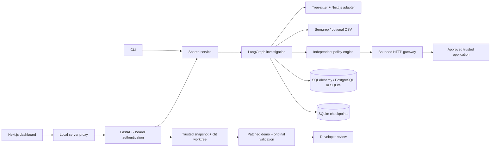

# Architecture

The graph has finite transitions: reconnaissance → hypotheses → planning → validation → reporting. Source observations produce typed hypotheses; optional LiteLLM prioritization can only select list indices. Plans expose GET, path, category, and synthetic identity. No shell or arbitrary HTTP tool is available to the model. Exceptions and cancellations are persisted. Provider retries are disabled; there are no autonomous loops. The isolated trusted patch fixture gets a bounded readiness retry loop, then a single regression execution.

Before every dynamic request the policy checks configured authorization and approval, category, request count, path syntax, synthetic fixture presence, and DNS addresses. Connections use the validated IP with the original Host header and TLS SNI, avoiding a second resolver call. DNS changes cause rejection. HTTPX ignores ambient proxies for target testing, follows no redirects, enforces timeouts, bounds decoded bodies to 64 KiB, and spaces requests. Scan cancellation cancels its running async task. A scanner already in a worker thread may finish its bounded subprocess, but dynamic requests stop immediately.

The database uses a versioned document schema with indexed kind and parent identifiers. JSON documents persist repositories, scans, hypotheses, plans, sanitized executions, findings, events, screenshots, settings, and patches. Alembic supplies schema evolution for SQLite and PostgreSQL. Local checkpoints use a separate SQLite database even with PostgreSQL. No live process is expected to survive a cloud snapshot or restart.

REST operations are under `/api/v1`; see generated OpenAPI at `/docs`. The API authenticates all non-health operations with a constant-time bearer comparison. There is one local operator role. SSE endpoints stream persisted events and terminate once a scan finishes. The Next.js server attaches the backend token and denies non-local hosts and cross-origin requests. The dashboard has no public identity system.

Patch verification is template-based and limited to three shipped demo defects. A checksum manifest anchors the reviewed source. A disposable Git snapshot includes only manifest-listed files, preserves original user files, and holds a separate worktree. Next runs with a minimal environment that excludes host credentials. Both the original security test and positive owner-access regressions must pass. Results and diffs persist; only the operator can decide to apply them. Worktree files remain for review, while the subprocess group is stopped in `finally` even on failure.

## Trusted demo browser adapter

`ScanCreate.browser` is an explicit opt-in and requires a dynamic scan of the reviewed demo, default fixtures, and approved IPv4 loopback origin. `demo_browser.py` owns three isolated Playwright contexts and a fixed UI scenario set. `DemoTransport` fulfills every allowed request through pinned HTTPX; no direct browser target connections, redirects, WebSockets, or service workers are permitted. Assets and fixed session POSTs share the same policy/request/rate budget as HTTP investigation. Each protected action records a server identity probe and a matching UI/network response projection. The graph stores browser verdicts separately and makes incomplete requested browser coverage inconclusive. Patch verification builds only reviewed disposable template copies with a minimal environment, repeats identical browser scenarios, and persists failures as unverified. Reports and authenticated PNG retrieval use sanitized artifacts; sessions never persist across runs. Arbitrary repository execution remains disabled.
